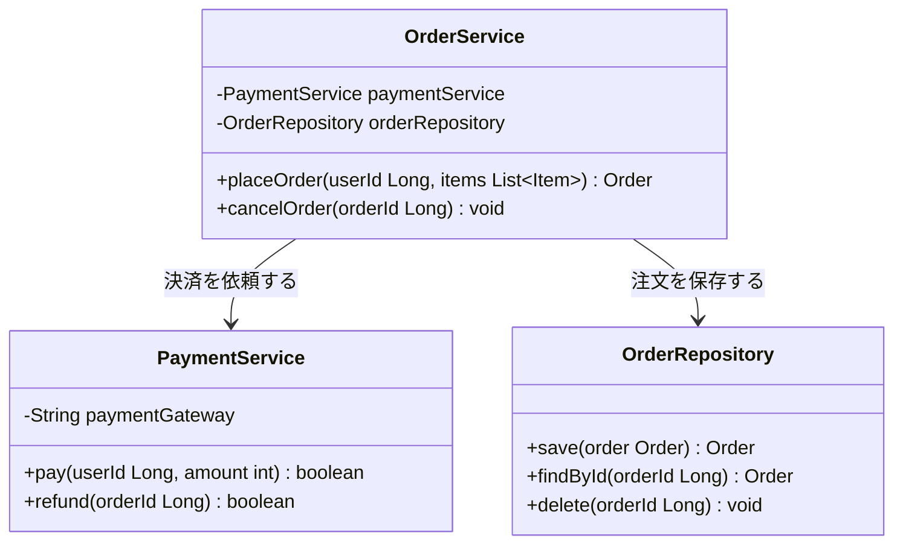
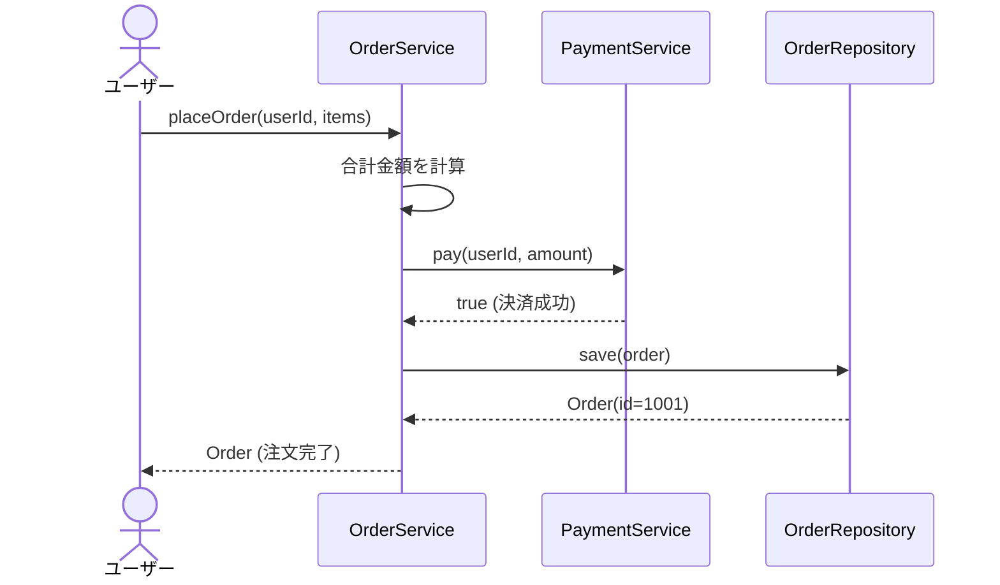

# 注文処理システム 詳細設計書

## 1. 概要

注文管理システムのうち、「注文処理」に関わる3つのクラス(OrderService / PaymentService / OrderRepository)の構造と呼び出しフローをUMLで記述する。

| クラス | 役割 |
|---|---|
| OrderService | 注文処理全体の流れを制御する(ビジネスロジック) |
| PaymentService | 決済処理を担当する |
| OrderRepository | 注文データの保存・取得(データアクセス)を担当する |

## 2. クラス図

### 2.1 フィールド・メソッド一覧

#### OrderService

| 種別 | 可視性 | 名前 | 型 / 戻り値 | 説明 |
|---|---|---|---|---|
| フィールド | private | paymentService | PaymentService | 決済処理を委譲する相手 |
| フィールド | private | orderRepository | OrderRepository | 注文データの保存先 |
| メソッド | public | placeOrder(userId, items) | Order | 注文を受け付け、決済と保存を行う |
| メソッド | public | cancelOrder(orderId) | void | 注文をキャンセルし、返金を行う |

#### PaymentService

| 種別 | 可視性 | 名前 | 型 / 戻り値 | 説明 |
|---|---|---|---|---|
| フィールド | private | paymentGateway | String | 利用する決済サービスの識別子 |
| メソッド | public | pay(userId, amount) | boolean | 決済を実行し、成功なら true を返す |
| メソッド | public | refund(orderId) | boolean | 返金を実行し、成功なら true を返す |

#### OrderRepository

| 種別 | 可視性 | 名前 | 型 / 戻り値 | 説明 |
|---|---|---|---|---|
| メソッド | public | save(order) | Order | 注文を保存し、採番済みの注文を返す |
| メソッド | public | findById(orderId) | Order | 注文IDで注文を1件取得する |
| メソッド | public | delete(orderId) | void | 注文を削除する |

## 3. シーケンス図

### 3.1 注文処理のシーケンス

ユーザー → OrderService → PaymentService → OrderRepository の順に呼び出される。時間は上から下へ流れる。

### 3.2 呼び出しフロー(時系列)

| 順序 | 呼び出し元 | 呼び出し先 | メッセージ | 内容 |
|---|---|---|---|---|
| 1 | ユーザー | OrderService | placeOrder(userId, items) | 注文を依頼する |
| 2 | OrderService | OrderService | 合計金額を計算 | 自己呼び出しで金額を算出 |
| 3 | OrderService | PaymentService | pay(userId, amount) | 決済を依頼する |
| 4 | PaymentService | OrderService | true | 決済結果を返す |
| 5 | OrderService | OrderRepository | save(order) | 注文を保存する |
| 6 | OrderRepository | OrderService | Order(id=1001) | 保存済みの注文を返す |
| 7 | OrderService | ユーザー | Order | 注文完了を返す |